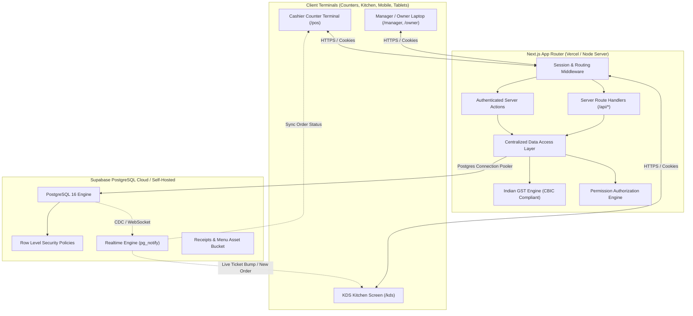

# POS.BITS — System Architecture Document

## 1. Executive Summary

POS.BITS is an enterprise-ready, multi-tenant Point-of-Sale (POS) and Restaurant Management Software-as-a-Service (SaaS) platform engineered specifically for Quick Service Restaurants (QSRs), cafes, and dessert parlours in India.

The architecture emphasizes:
1. **Zero UI Regression:** 100% preservation of the touch-first, high-density layout, color tokens, and workflows.
2. **Strict Multi-Tenancy:** Robust tenant and outlet isolation enforced at both application (Next.js Data Access Layer) and database layers (PostgreSQL Row Level Security).
3. **Single Source of Truth:** Supabase PostgreSQL manages identity, catalog, transactions, and kitchen queues. Eliminates local SQLite/Express discrepancies.
4. **Realtime Synchronization:** Sub-second kitchen ticket dispatch and bump status updates using Supabase Realtime channels.
5. **Indian Statutory Compliance:** Official CBIC GST rules, Rule 46 invoice particulars, Section 12(4) Place of Supply determination, and FSSAI license validation.

---

## 2. Technology Stack

| Layer | Technology | Justification |
|---|---|---|
| **Framework** | Next.js 15+ (App Router) | Server Components for zero-bundle data fetching, Route Handlers for APIs, robust SSR cookies |
| **Language** | TypeScript 5.9+ | End-to-end type safety from generated database schemas to frontend components |
| **Database & Auth** | Supabase (PostgreSQL 16) | Enterprise relational DB, Row Level Security, built-in Auth, Realtime replication |
| **Client State** | Zustand | Light-weight client state for active shopping cart, station filters, and transient UI modals |
| **Validation** | Zod | Runtime schema validation for API inputs, server actions, and onboarding forms |
| **Forms** | React Hook Form | High-performance, un-opinionated form state for multi-step onboarding & settings |
| **Styling** | Tailwind CSS + Custom Tokens | Consistent 8pt/16pt layout grids matching original design system (`image 3022.png`) |
| **Charts** | Recharts | Composable SVG financial analytics charts in Owner Dashboard and Reports |
| **Icons** | Lucide React | Modern, tree-shakeable icon set |

---

## 3. High-Level System Architecture

---

## 4. Layer Responsibilities

### 4.1 Client Layer
- Pure presentation and user interaction.
- Uses Server Components where data is read-only (Reports, Outlets List).
- Uses Client Components for interactive counter interfaces (Cart calculations, Keypad inputs, Drag-and-drop KDS).
- Never holds authority over prices, tax calculations, invoice numbers, or permission grants.

### 4.2 Next.js Data Access Layer (DAL)
- Single entry-point for database interactions.
- Enforces session verification via `@supabase/ssr`.
- Injects validated `tenant_id` and `outlet_id` from the server session—never trusting client-supplied route params or payload bodies.
- Invokes the Tax Engine for deterministic server-side financial calculations.

### 4.3 Database Layer (PostgreSQL)
- Schema-level constraints: foreign keys, check constraints, non-null guarantees.
- PostgreSQL Row Level Security (RLS) acts as the ultimate defense-in-depth security perimeter.
- Immutable transaction records for completed orders and generated invoices.
