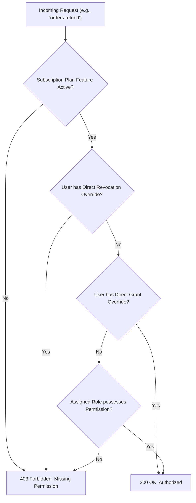

# POS.BITS — Authentication & Granular RBAC Specification

## 1. Authentication Architecture

### 1.1 Core Identity via Supabase Auth
- All users (Cashiers, Kitchen Staff, Managers, Owners, Platform Admins) authenticate through **Supabase Auth** backed by `auth.users`.
- Every employee has an individual corporate or store email address (e.g., `priya@signlaban.in`).
- Session management is handled securely via **HTTP-only, SameSite SSR Cookies** managed by `@supabase/ssr`.
- Token refreshing and session expiry are managed automatically on the server side.

### 1.2 Elimination of Fake Role Switchers
- **Strict Prohibition:** No role-selection cards (`role_select`), role-switching dropdowns, or mock impersonation buttons.
- The logged-in user's identity alone determines their accessible routes, data scope, and UI views.
- Attempts to access unauthorized routes trigger a standard 403 Forbidden boundary (`AccessDenied`).

### 1.3 Fast Terminal Unlock & Manager Approval PINs
- Four-digit PINs are **NEVER** used as primary authentication credentials.
- A logged-in terminal session may be temporarily "locked" for quick cashier swaps or screen protection.
- Unlocking a locked station or authorizing a sensitive action (voiding an item, applying an override discount, popping the cash drawer) can be done with a 4-digit PIN verified server-side:
  - PINs are hashed using `bcrypt` (salt rounds ≥ 10).
  - Rate-limited to 5 incorrect attempts before temporary account lockout (15 minutes).
  - Every PIN verification attempt is logged in `audit_logs`.

---

## 2. Granular Role-Based Access Control (RBAC)

### 2.1 Permission Catalog

Permissions are defined as string keys representing atomic capabilities:

| Permission Key | Description |
|---|---|
| `pos.access` | Access POS Counter terminal interface |
| `pos.custom_price` | Override standard item prices during order entry |
| `pos.discount.apply` | Apply cart-level or item-level discounts |
| `pos.discount.override` | Exceed standard discount threshold (e.g. > 15%) |
| `pos.drawer.open` | Trigger no-sale cash drawer solenoid opening |
| `orders.view` | View today's and historical orders |
| `orders.create` | Submit new orders and fire kitchen tickets |
| `orders.cancel` | Cancel unfulfilled orders |
| `orders.refund` | Process payment refunds and issue credit notes |
| `payments.process` | Settle bills and collect payments |
| `kds.access` | View and operate Kitchen Display System stations |
| `kds.bump` | Advance or bump kitchen ticket status |
| `kds.recall` | Recall bumped ticket history back to active board |
| `kds.item86.toggle` | Mark menu items out-of-stock (86) from kitchen |
| `tables.manage` | Manage dining room tables, seating, and bill requests |
| `shift.reconcile` | Access cash float and perform end-of-day shift balancing |
| `menu.view` | View menu items, pricing, and modifier groups |
| `menu.manage` | Add, edit, or delete dishes, prices, and add-ons |
| `staff.manage` | Invite employees, assign roles, and reset PINs |
| `roles.manage` | Create custom roles and configure permissions |
| `reports.view` | View financial dashboards, sales summaries, and tax reports |
| `reports.export` | Download CSV and GSTR compliance export packages |
| `settings.manage` | Configure store profile, hardware, printers, and sequences |
| `tax.manage` | Configure GST rates, tax profiles, and invoice templates |
| `platform.admin` | Unrestricted platform super-admin access across tenants |

### 2.2 Effective Permission Resolution Algorithm

An action is authorized if and only if:

$$\text{Effective Permission} = (\text{Plan Feature Enabled}) \land [(\text{Role Permission} \setminus \text{Revocations}) \cup \text{Direct Grants}]$$

### 2.3 Example Scenario
1. Employee **Sunil** holds the base role `Cashier`.
2. By default, `Cashier` has `['pos.access', 'orders.create', 'payments.process']`.
3. The store manager grants Sunil an individual override for `menu.manage` and `orders.refund` during evening shifts.
4. Sunil's role title remains `Cashier`, but his **effective permissions** include `menu.manage` and `orders.refund`.
5. The UI dynamically enables the menu editing button and refund modal for Sunil without hardcoded role checks.
