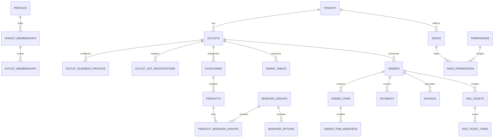

# POS.BITS — Multi-Tenant Database Schema Architecture

## 1. Design Principles

1. **Relational Integrity:** Explicit foreign keys with appropriate `ON DELETE RESTRICT` or `ON DELETE CASCADE`.
2. **Deterministic Financials:** `NUMERIC(12,2)` for all monetary values, percentages, and taxes. Never use floating-point types (`FLOAT`, `REAL`, `DOUBLE`).
3. **Tenant & Outlet Isolation:** Every business table carries `tenant_id UUID NOT NULL REFERENCES tenants(id)`. Outlet-specific operational tables also carry `outlet_id UUID NOT NULL REFERENCES outlets(id)`.
4. **Row-Level Security (RLS):** Enabled on all tenant tables with strict policies bound to the user's active tenant and outlet memberships.
5. **Auditing & Timestamps:** UTC timestamps (`TIMESTAMPTZ`), created/updated columns, and soft deletion (`deleted_at TIMESTAMPTZ`) for historical compliance.
6. **Immutable Historical Records:** Once an order is completed and an invoice is generated, the item names, unit prices, taxes, and customer details are captured in an immutable snapshot.

---

## 2. Entity-Relationship Overview

---

## 3. Schema Catalog

### 3.1 Platform Administration & Subscriptions
- `platform_admins`: System super administrators with cross-tenant diagnostic clearance.
- `subscription_plans`: Plan tiers (`starter`, `growth`, `enterprise`) with max outlets and support SLAs.
- `plan_features`: Granular platform features (`kds`, `reports_advanced`, `multi_outlet`, `api_access`).
- `tenant_subscriptions`: Active plan assignment, billing period, and status (`trial`, `active`, `suspended`).
- `tenant_feature_overrides`: Granular override to enable or disable specific features per tenant.

### 3.2 Business & Outlets
- `tenants`: Primary multi-tenant boundary (Legal Entity Name, Brand Slug, Primary Contact).
- `outlets`: Physical branch locations (Indiranagar, Koramangala, etc.).
- `outlet_business_profiles`: Display name, phone, email, FSSAI licence number, receipt header/footer, currency.
- `outlet_gst_registrations`: GSTIN, state code, registration type (`regular`, `composition`, `unregistered`), registered address.
- `states`: Indian states and union territories master table with 2-digit GST state codes (e.g., `29` for Karnataka, `27` for Maharashtra).

### 3.3 Identity, Access & Audit
- `profiles`: User identity linked 1:1 with `auth.users(id)` (Full Name, Phone, Avatar).
- `tenant_memberships`: Links profile to tenant with default role and active status.
- `outlet_memberships`: Scopes employee access to one or more physical outlets.
- `roles`: Tenant-customizable roles (`Cashier`, `Kitchen Lead`, `Shift Supervisor`, `Store Manager`, `Owner`).
- `permissions`: Master dictionary of system capabilities (`pos.access`, `orders.create`, `orders.void`, etc.).
- `role_permissions`: Join table mapping roles to permissions.
- `user_permission_overrides`: Direct overrides granting or revoking specific permissions for an individual employee.
- `staff_pins`: Bcrypt-hashed 4-digit PINs used exclusively for fast terminal unlock or manager step-up approvals with rate-limiting counters.
- `audit_logs`: Immutable security and transactional ledger (user ID, tenant, outlet, action, IP, payload delta).

### 3.4 Menu Engineering & Operations
- `categories`: Menu categories (Desserts, Beverages, Snacks) with display sort order.
- `products`: Dishes with SKU, base price, tax SAC/HSN code, kitchen preparation station (`Grill`, `Fry`, `Cold`, `Expo`), and availability toggle (`is_available`).
- `modifier_groups`: Customization groups (Sugar Level, Ice Level, Choice of Sauce, Premium Toppings).
- `modifier_options`: Individual add-on choices with extra price and stock status.
- `dining_tables`: Floor plan seating (Table Number, Cover Capacity, Status: `available`, `seated`, `billed`).

### 3.5 Orders, Payments & Kitchen Dispatch
- `orders`: Transaction root (Order Number, Token Sequence, Type: `dine_in`, `takeaway`, `delivery`, Subtotal, Discount, Tax, Net Total, Status).
- `order_items`: Order line items with historical snapshot of product name and unit price.
- `order_item_modifiers`: Selected modifiers linked to line items.
- `payments`: Tender entries (Mode: `upi_qr`, `cash`, `card_edc`, `split`, Reference Number, Tendered Amount, Change Returned, Status: `completed`).
- `kds_tickets`: Kitchen station routing ticket (Station, Status: `new`, `cooking`, `ready`, `bumped`, Elapsed Timers, Rush Flag).
- `kds_ticket_items`: Individual dish status on the station board.

### 3.6 Tax, Compliance & Billing
- `tax_profiles`: Applicable tax scheme (`gst_5_no_itc`, `gst_18_with_itc`, `composition_1`).
- `tax_components`: CGST, SGST, UTGST, IGST breakdown components.
- `invoices`: Official GST Tax Invoice or Bill of Supply (Rule 46 compliant) with consecutive sequential numbering.
- `invoice_sequences`: Atomic sequence generators ensuring unbroken serial numbering per financial year (e.g., `SL-2026-000104`).
- `credit_notes`: Tax reversal documents for refunded or cancelled invoices.
