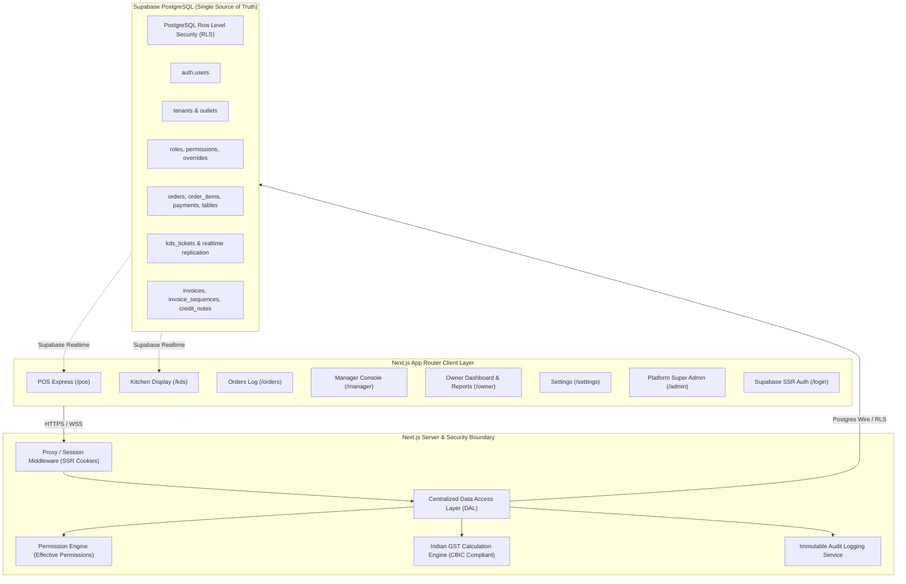

# POS.BITS — Production SaaS Engineering Transformation: Migration Plan (Phase 0)

**Document Version:** 1.0.0  
**Target Architecture:** Next.js App Router (TypeScript) + Supabase PostgreSQL (Single Source of Truth)  
**Scope:** Transformation from mock/vibe-coded POS prototype to multi-tenant, enterprise-grade restaurant SaaS.

---

## 1. What Currently Exists

The repository currently contains a complete, highly-detailed QSR (Quick Service Restaurant) POS frontend prototype built with Vite, React 19, TypeScript, and Tailwind CSS, supplemented with a temporary Express + SQLite/Prisma development backend:

### 1.1 UI Screens & Routes
- **POS Express Counter (`/pos`)**: Touch-first 8-inch/10-inch counter interface with product catalog, category tabs, product customization popup (free/paid toppings, sugar/ice levels, steppers), dynamic cart, quick-tender cash calculations, multi-payment options, customer lookup, table selection, and loyalty rewards.
- **Dine-In Tables (`/pos` & `/tables`)**: Visual dining floor plan with 12 table slots, live occupancy status (Available, Seated, Billed), Pax stepper, and running table tabs.
- **Kitchen Display System (`/kds`)**: 3-column Kanban board (New, In Preparation, Ready for Dispatch) with station routing (All Stations, Grill, Fry, Cold, Expo), overdue ticket flash timers, bumped ticket history with recall, item 86 (out-of-stock) toggles, recipe SOP modal, ticket actions menu, and station display lock.
- **Today's Orders (`/orders`)**: Complete daily orders ledger with search, order type filtering, live fulfillment status, thermal reprint triggers, and refund initiation.
- **Shift Reconciliation (`/shift`)**: Cash drawer management with opening float entry, note denomination counter (₹2000 down to ₹1), cash in/out movement logs, blind cash count variance calculation, and end-of-shift reporting.
- **Manager Console (`/manager`)**: 5 operational sub-consoles: Menu & Dish catalog, Modifiers & Add-on groups, Staff roster & PIN administration, Refund/void approval queue, and Store operations & device diagnostics.
- **Owner Dashboard & Reports (`/owner` & `/owner/reports`)**: Executive revenue KPIs, BCG Matrix product classification, hourly sales rush curve, payment mode split, and 10 dedicated reports (Sales Summary, Item Sales, Category Performance, Payment Modes, Hourly Rush, Staff Performance, Discounts & Refunds, GST Tax Audit, Kitchen Timers, GSTR-1 CA Package).
- **Settings (`/settings`)**: 9 system configuration tabs (Business Profile, GST & Tax Engine, 80mm Receipt Designer, Thermal Printers & Peripherals, KDS Settings, Payment Modes, Order Sequences, Roles & Permissions, Database Reset).
- **Admin & Platform Portal (`/admin`)**: Multi-tenant business switcher, outlet onboarding drawer, platform feature flags, and latency telemetry.
- **Authentication & Setup (`/login` & `/setup`)**: Role card switcher, 4-digit PIN touch keypad, email/password credential login, and a 4-step first-run setup wizard.

### 1.2 State & Storage
- **Zustand (`src/store/index.ts`)**: Monolithic 1,300+ line store containing all application state persisted in `localStorage` under `sign_laban_pos_v2`.
- **Mock Seed Data (`src/data/seedData.ts`)**: Hardcoded arrays for users, businesses, settings, historical orders, petty cash, and attendance.
- **Express + Prisma + SQLite (`server/index.ts` & `prisma/schema.prisma`)**: A lightweight local REST server on port 5001 connected to `dev.db`, providing mock JWT generation and bcrypt PIN verification.
- **Supabase Prototype Schema (`supabase/schema.sql`)**: Initial SQL migration creating `profiles` and `tenants` tables with basic RLS.

---

## 2. What Can Be Reused

The visual design system, component layout, and user workflows are nearly finalized and **must be 100% preserved**:

1. **Design System & Theme Tokens**:
   - `src/theme/index.css`: Color variables, typography rules, surface styles, badge tokens, animations.
   - `tailwind.config.js` & PostCSS configuration: Custom color scales (`primary-500: #ff4750`, `secondaryGreen-500: #40c4aa`, `canvas: #f8fafc`).
   - SVG icons, product assets, and brand imagery in `public/assets/`.
2. **Feature Components**:
   - POS layout (`POSPage.tsx`, `ProductCustomizationModal.tsx`, `CustomerInfoModal.tsx`, `HeldOrdersModal.tsx`, etc.).
   - KDS layout (`KDSPage.tsx`, `ExpandedTicketDrawer.tsx`, `BumpedTicketsView.tsx`, `TicketActionsMenu.tsx`, etc.).
   - Shift management views (`ShiftPage.tsx`, denomination counters).
   - Manager Console sub-views (`ManagerConsolePage.tsx`).
   - Owner Dashboard & Reports (`OwnerDashboardPage.tsx`, `ReportsPage.tsx` charts with Recharts).
   - Settings components (`SettingsPage.tsx`).
   - Setup Wizard steps (`SetupWizardPage.tsx`).
3. **Utility Formats & Calculations**:
   - `src/utils/formatters.ts`: Currency formatting (`formatINR`), date/time formatting, elapsed minute calculation.
   - `src/utils/audio.ts`: Kitchen and POS audio cues (Web Audio API synthesizers).
4. **Reference Material & Wireframes**:
   - `reference_designs/`: 54 source-of-truth PNG reference screens.
   - `figma-wireframes/`: Vector wireframe exports across Desktop, Tablet, and Mobile.
   - `ui-kit/`: Design token definitions and PDF documentation.

---

## 3. What Needs to Be Rewritten

To achieve a true production SaaS architecture, the mock and hybrid layers must be re-engineered from the ground up:

1. **Application Framework (Vite → Next.js App Router)**:
   - Migrate from client-only Vite SPA (`react-router-dom`) to Next.js App Router (`next/navigation`, Server Components by default, Client Components where interaction requires it).
   - Secure cookie-based session handling via `@supabase/ssr`.
2. **Authentication & Identity**:
   - Eliminate client-side role switching buttons and dropdowns.
   - Implement real Supabase Auth (email/password, password reset, secure session cookies).
   - Replace plaintext/mock PIN logins with server-side authenticated sessions. Standalone 4-digit PINs are restricted to fast terminal unlock or supervisor step-up authorization, backed by bcrypt hashes and rate limiting.
3. **Authorization & RBAC**:
   - Shift from fixed role checks (`user.role === 'cashier'`) to granular, permission-based RBAC (`pos.access`, `orders.create`, `menu.manage`, `reports.view`).
   - Support custom tenant roles and individual employee permission overrides.
   - Enforce authorization in Next.js Server Actions / Route Handlers AND PostgreSQL Row-Level Security (RLS).
4. **Database Architecture & Multi-Tenancy**:
   - Replace SQLite and Prisma with Supabase PostgreSQL as the **single source of truth**.
   - Design a normalized relational schema with explicit `tenant_id` and `outlet_id` scoping, UUID keys, foreign-key constraints, and `NUMERIC(12,2)` for financial calculations (no floating-point currency).
5. **Indian GST & Compliance Engine**:
   - Replace flat 5% frontend tax calculation with a centralized server-side tax service based on official CBIC notifications.
   - Support GST-registered (Regular 5% without ITC, 18% with ITC) vs Composition vs Unregistered restaurants.
   - Support intra-state (CGST + SGST/UTGST) vs inter-state (IGST) determination under Section 12(4) of the IGST Act.
   - Sequential, tamper-proof invoice numbering per financial year under Rule 46.
6. **Data Layer & Realtime**:
   - Replace local Zustand `localStorage` persistence with Supabase PostgreSQL queries and real-time subscriptions (`supabase.channel`) for live KDS and POS synchronization.

---

## 4. What Can Safely Be Removed

The following obsolete, redundant, or development-only artifacts must be cleaned up to ensure a clean production repository:

1. **Obsolete Backend & Competing Databases**:
   - `server/index.ts` (Express server).
   - `prisma/` directory (`dev.db`, `schema.prisma`, `seed.ts`).
   - Prisma CLI scripts in `package.json`.
2. **Temporary / Duplicate Files**:
   - `export-ui-gallery.html` (991 KB duplicate HTML file in workspace root; figma-wireframes retains master assets).
   - `pos-bits-ui-screens.zip` (5.5 MB archive in workspace root; preserved in `.user_uploaded` and artifacts).
   - Temporary test scripts (`scripts/test_backend_api.ts`).
   - `.DS_Store` files in all directories.
   - Old build output (`dist/`).
3. **Mock Stores & Local Role Switchers**:
   - Client-side role override dropdown in `Header.tsx`.
   - Insecure localStorage sync channel fallback.

---

## 5. Proposed Production Architecture



### Folder Structure (Next.js App Router Target)

```
POS_MVP/
├── app/                        # Next.js App Router pages and layouts
│   ├── (auth)/login/           # Real email/password & staff invitation login
│   ├── (dashboard)/            # Authenticated application shell
│   │   ├── pos/                # POS Express counter
│   │   ├── kds/                # Kitchen Display System
│   │   ├── orders/             # Today's orders log
│   │   ├── shift/              # Shift cash balancing
│   │   ├── manager/            # Manager operations console
│   │   ├── owner/              # Owner executive dashboard & reports
│   │   ├── settings/           # Store & tax configuration
│   │   └── admin/              # Platform Super Admin hub
│   ├── api/                    # Server Route Handlers (webhooks, exports)
│   ├── layout.tsx              # Root HTML layout & fonts
│   └── globals.css             # Design tokens & Tailwind styles
├── components/                 # Shared UI components (Header, Keypad, Modals)
├── features/                   # Domain-specific UI features & modal drawers
├── lib/
│   ├── supabase/               # Client, Server, and Admin Supabase clients
│   ├── auth/                   # Session verification & current user DAL
│   ├── rbac/                   # Granular permission checker
│   └── tax/                    # Indian GST & decimal billing engine
├── services/                   # Application service layer
├── types/                      # Database & domain TypeScript definitions
├── schemas/                    # Zod validation schemas
├── supabase/
│   └── migrations/             # Version-controlled SQL migrations
├── docs/                       # Architecture, GST, RBAC & API documentation
├── public/                     # Images, product assets, and logos
└── tests/                      # Automated unit, integration, and e2e tests
```
